# 나만의 파이썬 퀴즈 게임

## 1. 프로젝트 개요

Python 기초 문법을 학습하고, 터미널에서 실행되는 퀴즈 게임을 직접 만드는 프로젝트입니다.

사용자가 메뉴를 선택하여 퀴즈를 풀고, 새로운 문제를 추가하고, 퀴즈 목록과 최고 점수를 확인할 수 있는 프로그램을 만드는 것이 목표입니다.

## 2. 개발 환경

- 운영체제: Windows
- 코드 편집기: Visual Studio Code (VS Code)
- 터미널: PowerShell
- Python 버전: 3.14.10
- Git 버전: 2.56.0.windows.1
- 프로젝트 폴더: python-study

## 3. 개발 환경 확인

### Python 버전 확인

터미널에서 다음 명령어를 실행했습니다.

```powershell
py --version
```

실행 결과:

```text
Python 3.14.10
```

### Git 버전 확인

터미널에서 다음 명령어를 실행했습니다.

```powershell
git --version
```

실행 결과:

```text
git version 2.56.0.windows.1
```

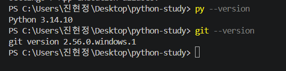

### Git 설정 확인

`git config`로 커밋에 기록되는 사용자 이름과 이메일을 확인했습니다.


### VS Code 개발 화면

VS Code에서 `python-study` 폴더를 열고 `quiz.py`를 작성했습니다.
왼쪽은 프로젝트 파일 목록, 가운데는 코드, 아래쪽은 터미널입니다.

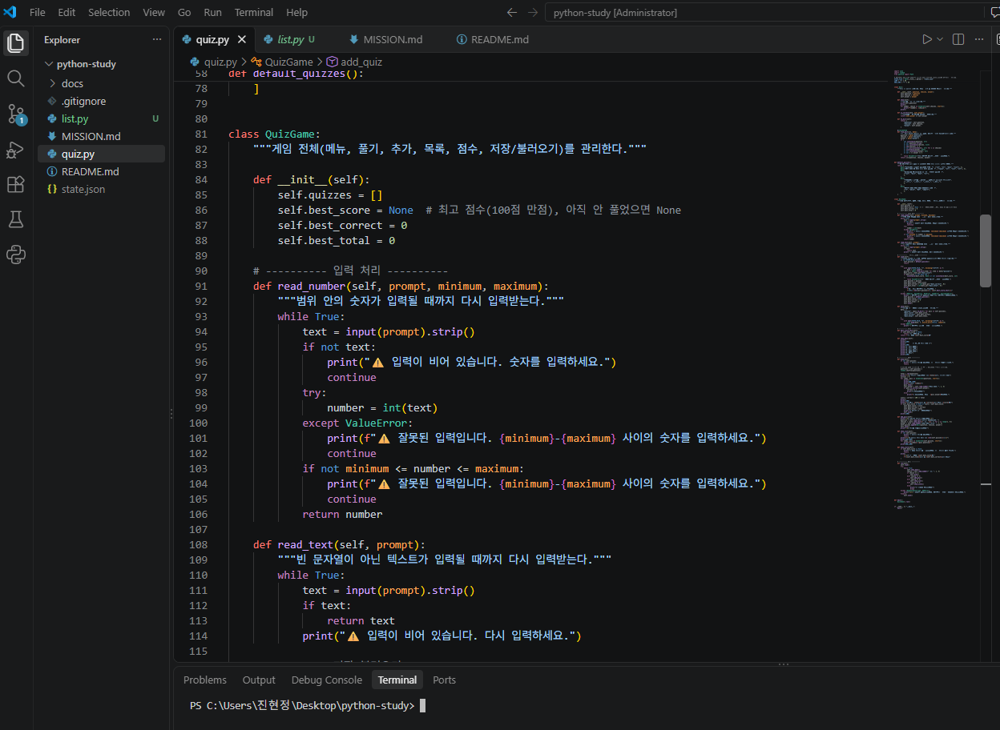


## 4. 개발 진행 기록


### 개발 환경 준비

- [x] Python 3.14.10 설치 및 버전 확인
- [x] Git 2.56.0 설치 및 버전 확인
- [x] VS Code 프로젝트 폴더 `python-study` 준비
- [x] Git 사용자 이름 확인
- [x] `README.md` 생성 및 개발 환경 기록
- [x] 개발 환경 스크린샷 저장
- [x] `.gitignore` 파일 생성
- [x] `git init`으로 로컬 저장소 초기화
- [x] 기본 브랜치를 `master`에서 `main`으로 변경
- [x] `git status`로 저장소 상태 확인
- [x] `git add`로 초기 파일 등록
- [x] 첫 번째 Git 커밋 완료
- [x] GitHub 원격 저장소 생성
- [x] 첫 번째 `git push` 실행
  
### Git 명령어 학습 기록

| 명령어 | 역할 |
|---|---|
| `git init` | 로컬 Git 저장소 생성 |
| `git status` | 파일과 저장소 상태 확인 |
| `git branch -m main` | 현재 브랜치 이름을 main으로 변경 |
| `git add` | 다음 커밋에 포함할 파일 준비 |
| `git commit -m` | 변경 내용을 설명과 함께 기록 |

### Git 명령어 실행 화면

#### 1. Git 저장소 초기화

`git init` 명령어로 로컬 저장소를 생성했습니다.


#### 2. Git 상태 확인

`git status` 명령어로 파일 상태를 확인했습니다.

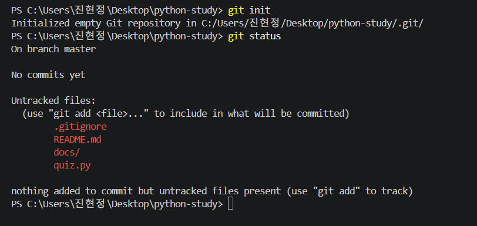

#### 3. 브랜치 이름 변경

`git branch -m main` 명령어로 브랜치 이름을 변경했습니다.

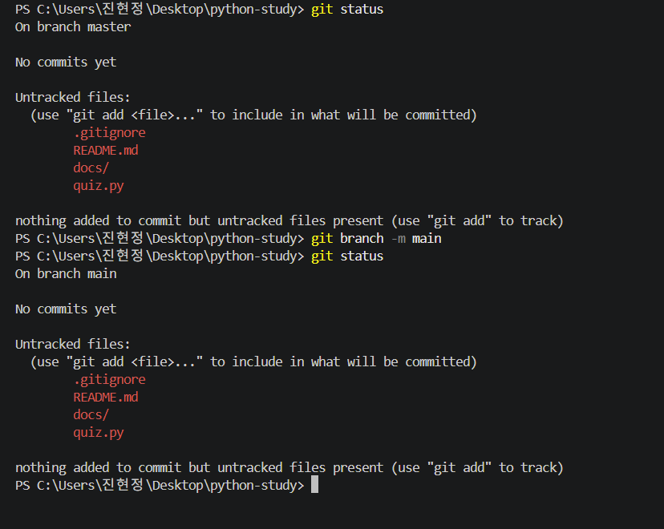

#### 4. Git 파일 등록

`git add` 명령어로 파일을 커밋할 준비를 했습니다.

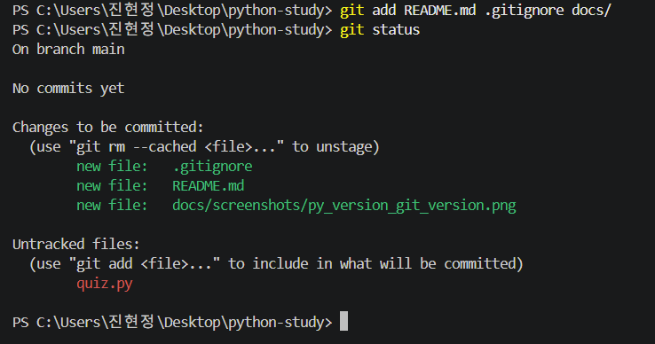

#### 5. 첫 번째 커밋

`git commit` 명령어로 첫 번째 변경 이력을 기록했습니다.

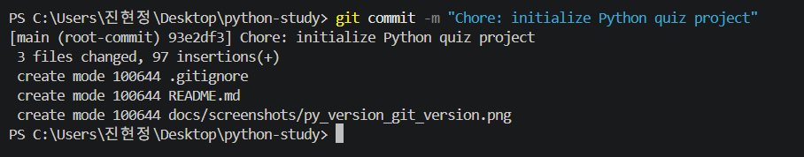

#### 6. Python 퀴즈 파일 생성 및 Git 상태 확인

`quiz.py` 파일을 생성하고 Python 코드를 작성하기 시작했습니다.

`git log --oneline`으로 기존 커밋을 확인하고,
`git status`로 새 파일이 아직 Git에 등록되지 않은 상태를 확인했습니다.

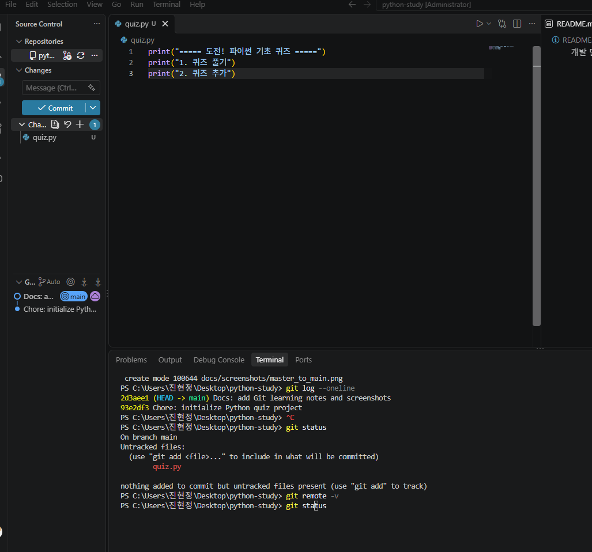

#### 7. Git 커밋 기록 확인

`git log --oneline` 명령어로 이 시점까지 생성한
3개의 커밋을 확인했습니다. (개발 초기의 기록이며,
최종 커밋 수는 아래 **Git 커밋 기록**에서 확인할 수 있습니다.)

세 번째 커밋 `7257b23`이 GitHub의
`origin/main`에도 반영된 것을 확인했습니다.

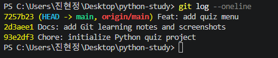


#### 8. Python 퀴즈 메뉴 개발 및 실행

##### 8-1. 메뉴 출력과 사용자 입력

`print()`로 퀴즈 게임 메뉴를 출력하고,
`input()`으로 사용자의 입력을 받았습니다.

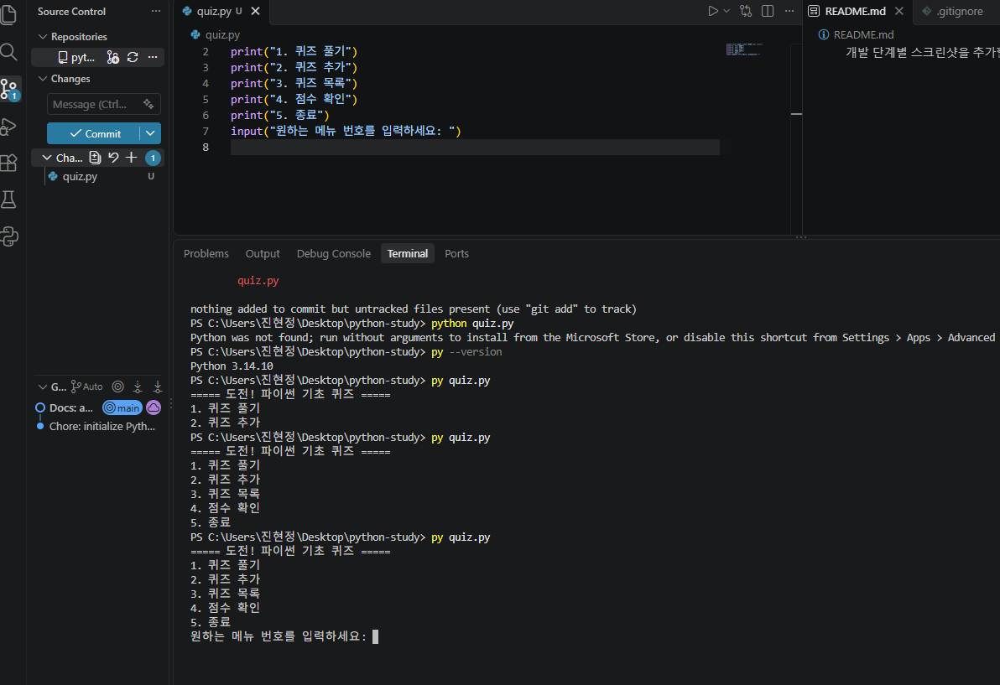

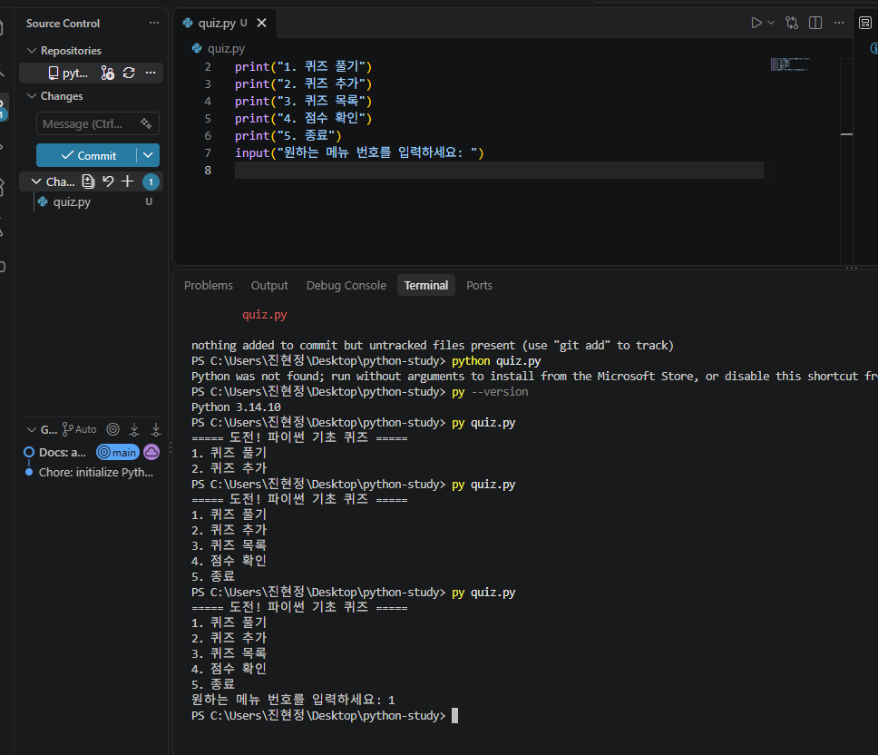

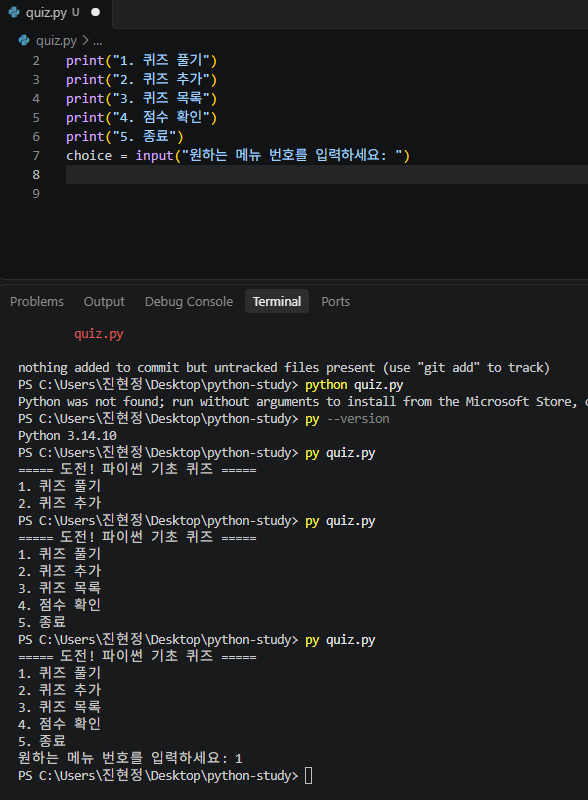

##### 8-2. Python 실행과 변수 학습

`python quiz.py` 실행 시 Python을 찾지 못하는 문제가 있어
`py quiz.py` 명령어로 실행했습니다.

입력받은 값을 `choice` 변수에 저장하는 방법을 학습했습니다.

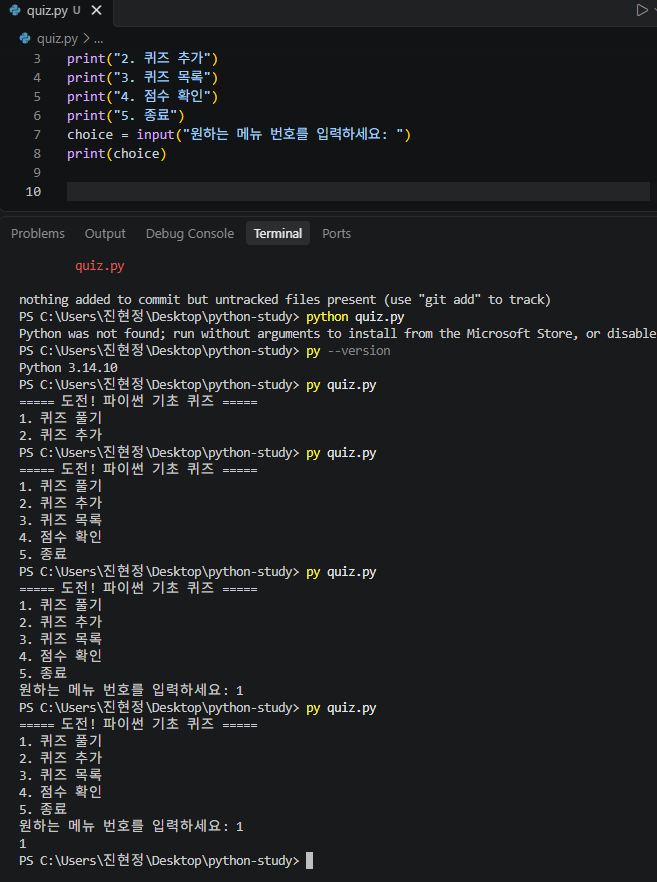

##### 8-3. 조건문 구현

`if`, `elif`, `else`를 사용하여 입력 번호에 따라
서로 다른 안내 문구가 출력되도록 구현했습니다.

조건문에 필요한 콜론(`:`)과 들여쓰기의 역할을 학습하고
잘못된 들여쓰기를 수정했습니다.

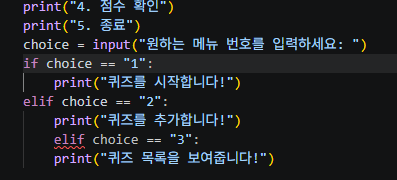

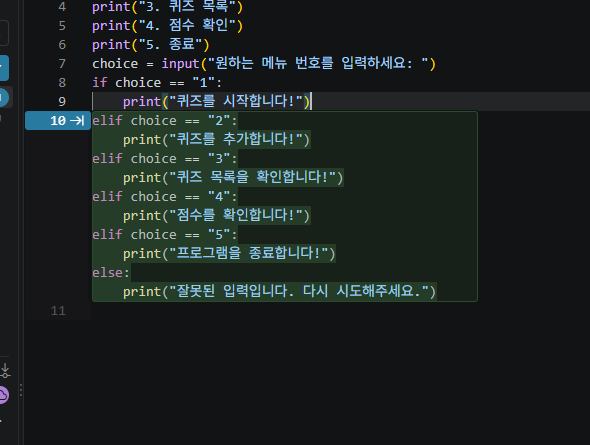

##### 8-4. 메뉴별 실행 확인

1번부터 5번까지 각각 입력하여
메뉴 안내 문구가 정상적으로 출력되는지 확인했습니다.

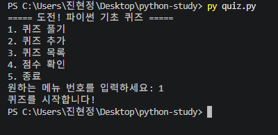

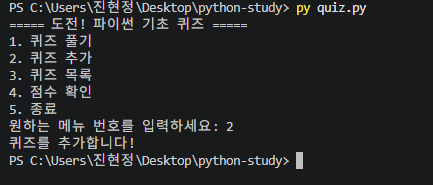

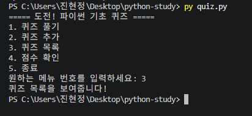

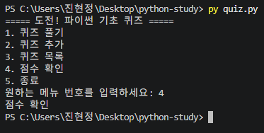

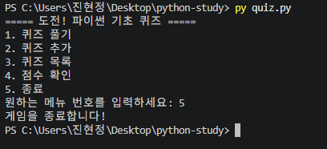

##### 8-5. 잘못된 입력 처리

처음에는 9번을 입력해도 안내 문구가 나오지 않았습니다.

`else` 조건을 추가한 뒤에는
잘못된 메뉴 번호라는 안내 문구가 출력되도록 수정했습니다.

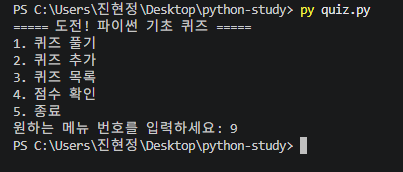

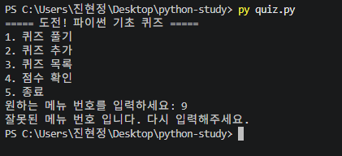

#### 9. 세 번째 Git 커밋 및 GitHub 업로드

`git add .`으로 변경 파일을 준비하고,
`git status`로 커밋할 파일을 확인했습니다.

`git commit -m "Feat: add quiz menu"`로
세 번째 커밋을 생성했습니다.

- 커밋 ID: `7257b23`
- 변경 파일: `quiz.py`
- 추가된 코드: 21줄

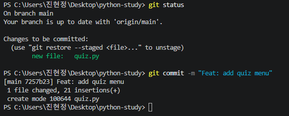

`git push` 명령어로 GitHub 원격 저장소에 업로드했습니다.

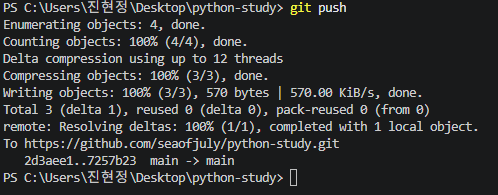


## 5. 퀴즈 주제 및 선정 이유

### 퀴즈 주제: Python 기초 문법

Python을 처음 배우면서 익힌 명령어와 기본 문법을
퀴즈로 복습하기 위해 이 주제를 선택했습니다.

자료형(`str`, `list`, `dict`), 클래스의 `__init__`, 반복문(`while`) 등
Python의 기초 개념을 문제로 만들고,
직접 풀면서 학습 내용을 확인하는 것이 목표입니다.

기본으로 제공되는 퀴즈 5개는 변수 자료형, 리스트와 딕셔너리,
클래스의 `__init__`, 반복문 등 Python 기초 개념으로 구성했습니다.
퀴즈는 메뉴에서 직접 추가할 수 있습니다.


## 6. 실행 방법

### 프로그램 실행

VS Code에서 `python-study` 폴더를 열고
터미널에 다음 명령어를 입력합니다. (Python 3.10 이상 필요)

```powershell
py quiz.py
```

프로그램이 실행되면 다음 메뉴가 나타납니다.

```text
========================================
        🎯 나만의 퀴즈 게임 🎯
========================================
1. 퀴즈 풀기
2. 퀴즈 추가
3. 퀴즈 목록
4. 점수 확인
5. 종료
========================================
선택:
```

원하는 메뉴 번호를 입력하면 해당 기능이 실행되고,
기능이 끝나면 다시 메뉴로 돌아옵니다. `5`를 입력하면 종료됩니다.

### 사용 예시

```text
선택: 1

📝 퀴즈를 시작합니다! (총 5문제, 순서는 랜덤)

----------------------------------------
[문제 1]
Python에서 문자열 자료형의 이름은?

1. int
2. str
3. bool
4. list

정답 입력: 2
✅ 정답입니다!
```

문제 순서는 퀴즈를 풀 때마다 랜덤으로 바뀌므로, 실행할 때마다 첫 문제가 다를 수 있습니다.


## 7. 주요 기능

### 구현한 기능

- [x] 퀴즈 게임 메뉴 5개 출력 및 메뉴 반복
- [x] 퀴즈 풀기: 문제 출제, 정답/오답 안내, 결과(점수) 표시
- [x] 퀴즈 추가: 문제, 선택지 4개, 정답 번호 입력 후 저장
- [x] 퀴즈 목록 확인
- [x] 최고 점수 확인 및 갱신 (퀴즈를 풀 때마다 비교)
- [x] `state.json`으로 퀴즈와 최고 점수 저장 및 불러오기
- [x] 기본 퀴즈 5개 제공 (파일이 없을 때 사용)
- [x] `Quiz`, `QuizGame` 클래스로 역할 분리
- [x] (보너스) 랜덤 출제: 퀴즈를 풀 때마다 문제 순서를 섞음

### 입력 및 예외 처리

- 입력 앞뒤 공백을 제거합니다. (예: ` 1 `)
- 빈 입력, 숫자가 아닌 입력(`abc`), 범위 밖 숫자(`9`, `0`)는 안내 메시지 후 다시 입력받습니다.
- `Ctrl+C`나 입력 종료(`EOFError`)가 발생해도 안내 메시지를 출력하고, 저장한 뒤 안전하게 종료합니다.
- `state.json`이 없으면 기본 퀴즈로 시작하고, 손상되었으면 안내 후 `state.json.bak`으로 백업하고 기본 퀴즈로 초기화합니다.


## 8. 프로젝트 파일 구조

현재 프로젝트는 다음과 같이 구성되어 있습니다.

```text
python-study/
├── quiz.py
├── state.json        (프로그램 실행 시 자동 생성)
├── README.md
├── MISSION.md
├── .gitignore
└── docs/
    └── screenshots/
```

### 파일 및 폴더 설명

| 이름 | 역할 |
|---|---|
| `quiz.py` | 퀴즈 게임 실행 코드 (`Quiz`, `QuizGame` 클래스) |
| `state.json` | 퀴즈 목록과 최고 점수 저장 파일 (UTF-8) |
| `state.json.bak` | 손상된 `state.json`의 백업 (손상이 감지될 때만 생성) |
| `README.md` | 프로젝트 설명과 개발 학습 기록 |
| `MISSION.md` | 미션 요구 사항 정리 |
| `.gitignore` | Git에서 추적하지 않을 파일 설정 |
| `docs/screenshots/` | 개발 과정 및 실행 결과 스크린샷 보관 |

### 클래스를 사용한 이유

퀴즈 한 문제의 데이터(`question`, `choices`, `answer`)와 동작(`show()`, `is_correct()`)을 `Quiz`로 묶고,
게임 전체의 상태(퀴즈 목록, 최고 점수)와 기능은 `QuizGame`으로 묶었습니다.
함수만 사용하면 `quizzes`, `best_score` 같은 값을 여러 함수에 계속 넘기거나 전역 변수로 공유해야 해서
코드가 커질수록 값이 어디서 바뀌는지 추적하기 어렵지만, 클래스는 데이터와 기능을 한곳에 모아 역할이 분명하고
`Quiz`를 여러 개 만들어 재사용할 수 있습니다.
대신 작은 프로그램에서는 `self`와 클래스 구조 때문에 함수만 쓸 때보다 코드가 조금 길어지는 단점이 있습니다.

### 코드 구조

| 클래스 / 메서드 | 역할 |
|---|---|
| `Quiz` | 퀴즈 한 문제 (`question`, `choices`, `answer`) |
| `Quiz.show()` | 문제와 선택지 출력 |
| `Quiz.is_correct()` | 정답 확인 |
| `QuizGame` | 게임 전체 관리 (퀴즈 목록, 최고 점수) |
| `QuizGame.read_number()` | 숫자 입력 검증 (공백, 변환 실패, 범위, 빈 입력) |
| `QuizGame.load()` / `save()` | `state.json` 불러오기 / 저장 |
| `QuizGame.backup_corrupted_file()` | 손상된 `state.json`을 `state.json.bak`으로 백업 |
| `QuizGame.play()` | 퀴즈 풀기와 점수 계산 |
| `QuizGame.add_quiz()` | 퀴즈 추가 |
| `QuizGame.show_list()` | 퀴즈 목록 출력 |
| `QuizGame.show_score()` | 최고 점수 출력 |
| `QuizGame.run()` | 메뉴 반복 실행 |

### 요구사항 변경 시 점검 대상

요구사항이 바뀌면 아래 표에서 해당 변경을 찾아 파일과 메서드를 확인합니다.
모든 코드는 `quiz.py` 한 파일에 있고, 문서는 `README.md`에 있습니다.

| 변경 요구 | 점검할 메서드 / 위치 |
|---|---|
| 선택지 개수 변경 (4개 → N개) | `Quiz.from_dict()`(선택지 개수, 정답 범위 검사), `QuizGame.add_quiz()`(선택지 입력 반복, 정답 범위), `QuizGame.play()`(정답 입력 범위), `default_quizzes()`, README 스키마 |
| 퀴즈에 속성 추가 (힌트, 분류 등) | `Quiz.__init__()`, `Quiz.to_dict()`, `Quiz.from_dict()`, `Quiz.show()`, `QuizGame.add_quiz()`, `default_quizzes()`, `state.json` 스키마 |
| 점수 계산 방식 변경 | `QuizGame.play()`(점수 계산, 최고 점수 갱신), `QuizGame.show_score()`, `QuizGame.best_score_text()`, `QuizGame.load()`/`save()`(`best_*` 값) |
| 저장 방식 변경 (JSON → DB 등) | `STATE_FILE`, `QuizGame.load()`, `QuizGame.save()`, `QuizGame.backup_corrupted_file()` (다른 메서드는 그대로 사용 가능) |
| 메뉴 항목 추가, 변경 | `QuizGame.show_menu()`, `QuizGame.run()`(메뉴 번호 범위와 분기), 새 기능 메서드 |
| 입력 검증 규칙 변경 | `QuizGame.read_number()`, `QuizGame.read_text()` |
| 기본 퀴즈 내용 변경 | `default_quizzes()` |
| 데이터 파일 위치, 이름 변경 | `STATE_FILE`, `.gitignore`, README 9번 항목 |


## 9. 데이터 파일 설명

### `state.json`

- **위치:** 프로젝트 루트 (`quiz.py`와 같은 폴더)
- **역할:** 프로그램을 종료해도 퀴즈와 최고 점수가 유지되도록 저장
- **인코딩:** UTF-8
- **생성:** 퀴즈를 추가하거나 최고 점수가 갱신될 때, 또는 종료할 때 자동으로 저장됩니다.

JSON은 데이터를 일정한 형식으로 저장하는 텍스트 형식입니다.
Python의 `dict`, `list`와 모양이 비슷해서 읽고 쓰기 쉽습니다.

### 스키마

| 키 | 타입 | 설명 |
|---|---|---|
| `quizzes` | list | 퀴즈 목록 |
| `quizzes[].question` | str | 문제 |
| `quizzes[].choices` | list(str) | 선택지 4개 |
| `quizzes[].answer` | int | 정답 번호 (1~4) |
| `best_score` | int 또는 null | 최고 점수 (100점 만점, 아직 안 풀었으면 `null`) |
| `best_correct` | int | 최고 점수를 낸 판의 정답 수 |
| `best_total` | int | 최고 점수를 낸 판의 문제 수 |

### 예시

```json
{
    "quizzes": [
        {
            "question": "Python에서 문자열 자료형의 이름은?",
            "choices": ["int", "str", "bool", "list"],
            "answer": 2
        }
    ],
    "best_score": 40,
    "best_correct": 2,
    "best_total": 5
}
```

### 예외 상황

- 파일이 없으면(첫 실행) 기본 퀴즈 5개로 시작합니다.
- 파일이 손상되었거나 형식이 맞지 않으면 안내 메시지를 출력하고, 손상된 파일을 `state.json.bak`으로 백업한 뒤 기본 퀴즈로 초기화합니다.

### 손상된 파일 복구

초기화하면 `state.json`이 새 내용으로 바뀌지만, 손상된 원본은 같은 폴더의 `state.json.bak`에 남아 있습니다.
`state.json.bak`을 열어 내용을 확인하고 고친 뒤 파일 이름을 `state.json`으로 바꾸면 이전 데이터를 되살릴 수 있습니다.
백업은 손상이 감지될 때마다 만들어지며, 이미 `.bak`이 있으면 가장 최근에 손상된 파일로 덮어씁니다.
`state.json.bak`도 `.gitignore`에 등록해서 Git에는 올리지 않습니다.

### 한계와 대용량 데이터 고려사항

이 프로젝트는 퀴즈가 수십 개 수준인 학습용 프로그램이라 JSON 파일 하나로 충분합니다.
다만 데이터가 아주 많아지면 다음 한계가 있습니다.

- **전체를 읽고 전체를 다시 씁니다.** `load()`는 `json.load()`로 파일 전체를 메모리에 올리고,
  `save()`는 퀴즈를 하나만 추가해도 `json.dump()`로 파일 전체를 다시 씁니다.
  퀴즈가 N개이면 읽기, 쓰기 시간과 메모리 사용량이 N에 비례해 커집니다.
- **저장 도중 종료되면 파일이 손상될 수 있습니다.** 현재는 손상된 파일을 감지하면 `state.json.bak`으로 백업한 뒤 기본 퀴즈로 초기화합니다.
- **동시에 여러 곳에서 쓰면 덮어쓸 수 있습니다.** 이 프로그램은 한 번에 하나만 실행하는 것을 전제로 합니다.

데이터가 수만 건 이상으로 커지면 다음 방법을 고려할 수 있습니다.

| 방법 | 설명 |
|---|---|
| DB로 전환 | 표준 라이브러리 `sqlite3` 등을 사용해 필요한 퀴즈만 조회하고 추가, 삭제합니다. 전체 파일을 다시 쓰지 않아도 됩니다. |
| 스트리밍 처리 | JSON Lines(`.jsonl`, 한 줄에 퀴즈 하나)로 저장해 한 줄씩 읽고, 새 퀴즈는 파일 끝에 추가합니다. 전체를 메모리에 올리지 않습니다. |
| 필요한 만큼만 읽기 | 퀴즈를 풀 때 한 번에 N문제만 불러오는 방식(페이지 단위 조회)으로 바꿉니다. |
| 안전한 저장 | 임시 파일에 먼저 쓴 뒤 `os.replace()`로 교체해, 저장 중 종료되어도 기존 파일이 남게 합니다. |

저장 방식을 바꿀 때 수정할 부분은 위 **요구사항 변경 시 점검 대상** 표의
"저장 방식 변경"을 참고합니다. (`load()`, `save()`만 바꾸면 됩니다.)


## 10. 실행 화면 및 개발 과정

Python 퀴즈 게임의 개발 과정과 실행 결과는
**4. 개발 진행 기록**에 정리했습니다.

### 퀴즈 게임 실행 결과

`py quiz.py`로 실행한 화면입니다.

#### 메뉴 화면

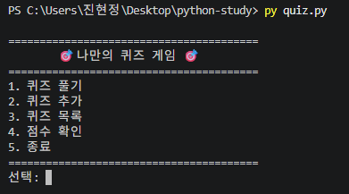

#### 퀴즈 추가

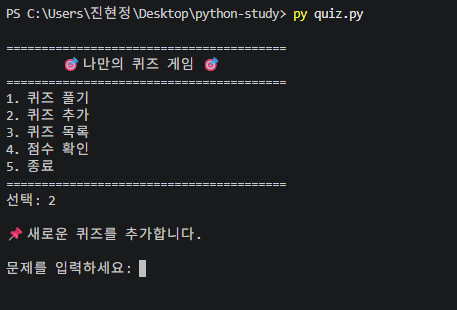

문제, 선택지 4개, 정답 번호를 입력하면 퀴즈가 추가됩니다.

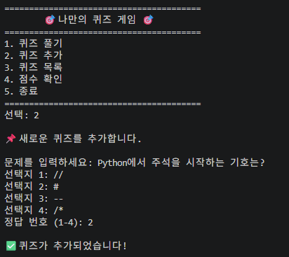

#### 퀴즈 목록

추가한 퀴즈가 목록에 반영되어 총 6개가 표시됩니다.

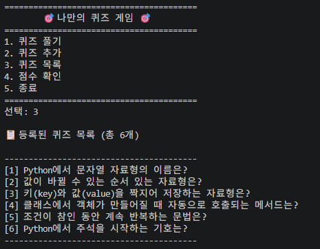

#### 퀴즈 풀기

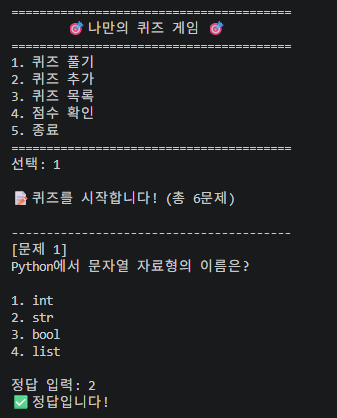

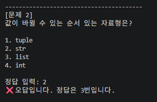

범위 밖 숫자(`9`)를 입력하면 안내 메시지를 출력하고 다시 입력받습니다.

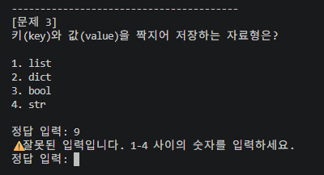

모든 문제를 풀면 결과와 점수가 표시되고, 최고 점수가 갱신됩니다.

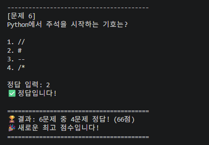

#### 점수 확인

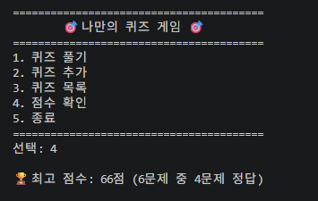

#### 재실행 후 데이터 유지

프로그램을 종료한 뒤 다시 실행해도 `state.json`에서 퀴즈와 최고 점수를 불러옵니다.

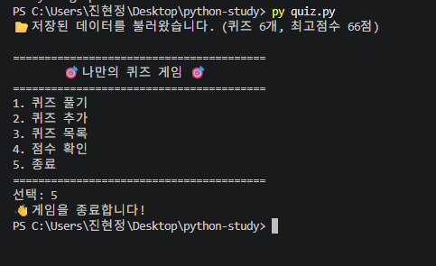

#### Git 커밋 기록

`git log --oneline --graph`로 확인한 커밋 기록입니다.
`feature/play-quiz` 브랜치를 만들어 작업한 뒤 `main`에 병합했습니다.

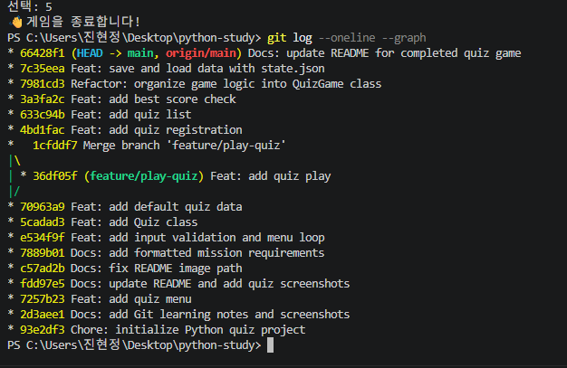

원격 저장소(GitHub)의 최종 커밋 수는 **30개 이상**으로,
과제의 최소 요구인 10개 이상을 충족합니다.
(`git rev-list --count HEAD`로 확인할 수 있습니다.)

기능 단위로 나눈 주요 커밋은 다음과 같습니다.

| 단계 | 커밋 | 메시지 |
|---|---|---|
| 저장소 초기화 | `93e2df3` | `Chore: initialize Python quiz project` |
| 메뉴 구현 | `7257b23` | `Feat: add quiz menu` |
| 입력 검증, 메뉴 반복 | `e534f9f` | `Feat: add input validation and menu loop` |
| `Quiz` 클래스 | `5cadad3` | `Feat: add Quiz class` |
| 기본 퀴즈 데이터 | `70963a9` | `Feat: add default quiz data` |
| 퀴즈 풀기 (`feature/play-quiz` 브랜치) | `36df05f` | `Feat: add quiz play` |
| 브랜치 병합 | `1cfddf7` | `Merge branch 'feature/play-quiz'` |
| 퀴즈 추가 | `4bd1fac` | `Feat: add quiz registration` |
| 퀴즈 목록 | `633c94b` | `Feat: add quiz list` |
| 점수 확인 | `3a3fa2c` | `Feat: add best score check` |
| `QuizGame` 클래스 정리 | `7981cd3` | `Refactor: organize game logic into QuizGame class` |
| `state.json` 저장/불러오기 | `7c35eea` | `Feat: save and load data with state.json` |
| README, 스크린샷 | `66428f1`, `da3e418` | `Docs: ...` |
| 보너스: 랜덤 출제 | `ea7f760` | `Feat: add random quiz order` |
| clone, pull 실습 | `16c2ec0`, `8bea294` | `Docs: ...` |

#### 브랜치를 나눈 이유와 병합

`main`은 항상 실행되는 안정된 상태로 두고, 퀴즈 풀기 기능은 `feature/play-quiz` 브랜치에서 따로 작업했습니다.
개발 중인 코드가 `main`에 섞이지 않고, 문제가 생기면 그 브랜치만 버릴 수 있습니다. (기능 격리)
기능을 완성하고 실행을 확인한 뒤 `git merge --no-ff`로 `main`에 합쳐서, 기능 단위의 이력이 그래프에 남게 했습니다.
같은 파일의 같은 부분을 서로 다른 브랜치에서 고치면 병합할 때 **충돌**이 나서 직접 비교해 풀어야 하고,
팀 작업에서는 병합하기 전에 Pull Request와 코드 리뷰로 변경 내용을 확인합니다.
이번 프로젝트는 혼자 작업해서 충돌은 발생하지 않았습니다.

#### Git clone / pull 실습

퀴즈 게임 개발을 마친 뒤 `clone`과 `pull`을 실습했습니다.

##### 1. clone: 저장소 복제

`git clone`으로 GitHub 저장소를 `python-study-clone` 폴더에 복제했습니다.
원래 작업 폴더(`python-study`) 옆에 복제 폴더가 생겼습니다.

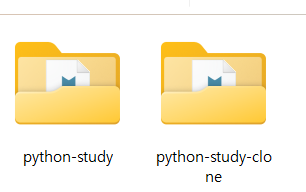

##### 2. 복제본에서 수정 후 commit, push

복제한 폴더(`python-study-clone`)의 `README.md`에 한 줄을 추가했습니다.

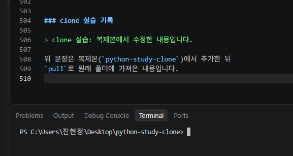

그다음 `git add`, `git commit`, `git push`로 GitHub에 올렸습니다.

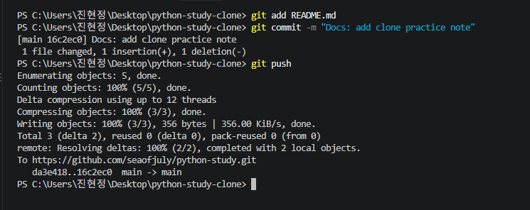

##### 3. 원래 폴더에서 pull

원래 작업 폴더로 돌아와 `git pull`로 변경사항을 가져왔습니다.
`Fast-forward`로 `README.md`가 갱신되었고,
`git log --oneline -3`에서 복제본에서 만든 커밋
`Docs: add clone practice note`를 확인했습니다.

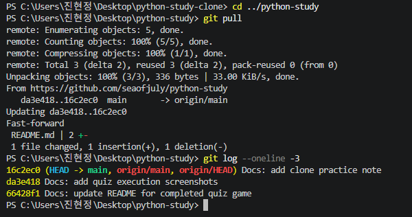

### 최종 확인 내용

- Python 및 Git 개발 환경 설정
- Git 저장소 생성과 GitHub 연결
- 퀴즈 풀기, 추가, 목록, 점수 확인 기능 구현
- `Quiz`, `QuizGame` 클래스로 코드 구조 분리
- `state.json`으로 퀴즈와 최고 점수 저장 및 불러오기
- 잘못된 입력, `Ctrl+C`, 파일 손상 등 예외 처리
- `feature/play-quiz` 브랜치 작업 후 `main`에 병합
- `clone`과 `pull` 실습
- (보너스) 랜덤 출제 구현

각 단계의 실행 화면은 `docs/screenshots/` 폴더에 저장했으며
README에서 확인할 수 있습니다.
